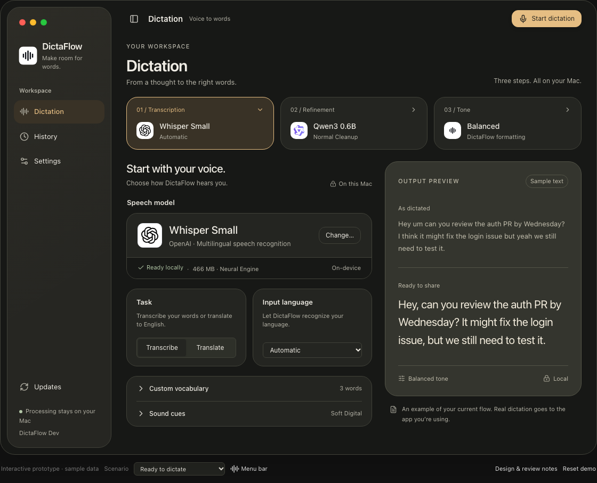

# DictaFlow Ember design signature

Implementation reference, 15 October 2026. This records the approved Ember direction with the latest simplifications. It is the visual contract for the native implementation, alongside [the interactive reference](index.html) and [implementation plan](IMPLEMENTATION_PLAN.md).

## Visual identity

Warm graphite, champagne highlights, soft inset surfaces, and a floating rounded sidebar. Light appearance uses warm ivory and brown. Keep the same composition, spacing, provider identity, and restrained contrast. Do not return to the earlier blue settings layout or substitute a generic grouped form for the approved workspace.

The screenshot includes prototype review controls below the app. Those controls are outside the product and must not ship.

## Final navigation and ownership

The sidebar contains **Dictation**, **History**, and **Settings**. **Updates** is a bottom utility. Settings has **General**, **Appearance**, and **Permissions** categories. There is no Overview or standalone Models destination.

| Setting or operation | Its only editing location |
| --- | --- |
| Speech model, task, input language, Neural Engine encoder | Dictation → Transcription; model operations open its picker |
| Custom vocabulary and sound cues, including style and cue previews | Dictation → Transcription disclosures |
| Refinement enablement, model, writing style, saved additions, DIY prompt | Dictation → Refinement; model operations open its picker |
| Original, Casual, Balanced, Formal tone | Dictation → Tone |
| Global recording shortcut and recording-time system audio behavior | Settings → General |
| Open storage folder | Settings → General → Storage |
| Light, Dark, System | Settings → Appearance |
| Microphone and Accessibility access/recovery | Settings → Permissions |
| Retention Off/7/14 days, delete history | History → History settings |
| Automatic update checks, installed version, release link | Bottom sidebar → Updates |

Read-only selected values on the three stage cards identify the pipeline. Menu bar stage rows link to the corresponding Dictation stage. They must not contain a second model picker, refinement toggle, tone selector, or sound-cue editor. Start/Stop remains available in the toolbar, menu bar, and global shortcut because these are capture entry points, not duplicate preference editors.

## Required omissions

- No Settings → Feedback section, sound-cue row, or link back to the sound-cue editor.
- No **Unused models**, **Remove unused**, bulk cleanup confirmation, unused-model count, or downloaded-model storage inventory anywhere in the redesigned UI. Storage has one folder action. Individual inactive-model removal stays in its model picker, preserving the existing core capability.
- No **How it works / Start recording** card below Storage.
- No decorative **Recording indicator preview** in Appearance.
- No persistent bottom status bar, **Ready · Processing on this Mac** label, or bottom shortcut keycaps. The content uses the reclaimed space.
- No **Your recordings stay local** card in Permissions.
- No extra refinement summary card below **Works with or without refinement**. Keep that sentence as plain guidance in Tone.
- No filler cards added to occupy the space left by these removals.

Removing the decorative recording preview does not remove the real listening/processing panel. Removing bulk cleanup does not delete any installed files. A conditional download accessory appears in the toolbar only while a download is active or has failed; it opens the existing picker and disappears when no activity needs attention.

## Color contract

Values are sRGB. Use these as semantic native theme tokens; retain the existing `ThemeColor` appearance resolution. The primary action has its own foreground token, so dark text is used on champagne in Dark appearance.

| Role / prototype token | Dark | Light |
| --- | --- | --- |
| Window / `bg` | `#171816` | `#F3F0E9` |
| Cards / `surface` | `#242521` | `#FFFDF8` |
| Inset controls / `well` | `#2E3029` | `#EAE6DC` |
| Primary text / `text` | `#F0EDE5` | `#2F322B` |
| Secondary text / `muted` | `#B6B4A8` | `#66695F` |
| Dividers / `line` | `#414239` | `#D8D4C8` |
| Selection accent / `accent` | `#E6BE83` | `#785422` |
| Selected surface / `accent-soft` | `#393226` | `#E8DDCA` |
| Primary action / `action` | `#E6BE83` | `#765126` |
| Action text / `action-ink` | `#27251F` | `#FFFAF0` |
| Success / `green` | `#B3C7A7` | `#426745` |
| Error text / `red` | `#F2A6A2` | `#AD3B38` |
| Warning / `amber` | `#E6BE83` | `#85510C` |
| Reading surface / `paper` | `#34352E` | `#EAE1CF` |
| Reading divider / `paper-line` | `#535447` | `#CFC3AD` |
| Reading text / `paper-ink` | `#F4EDDD` | `#37392F` |
| Reading secondary / `paper-muted` | `#C3BFAE` | `#626354` |
| Error surface / `error-bg` | `#392824` | `#F7E6E2` |
| Error outline / `error-line` | `#81514A` | `#D5A49A` |
| Error content / `error-ink` | `#F0B6AA` | `#8E3029` |

Sidebar material tint: Dark `rgba(38,39,34,0.96)`, Light `rgba(233,228,216,0.94)`. Transient glass tint: Dark `rgba(45,46,40,0.97)`, Light `rgba(249,245,236,0.97)`. These describe the HTML reference; use native materials with an appropriate tint and an opaque fallback. Do not imitate blur by blurring text or form content.

Missing models, failed model/encoder downloads, blocked recording permissions, and unavailable refinement use the error surface, outline, and content together. Include a status icon, clear explanation, and an applicable recovery action. Off, optional, downloading, and ordinary unselected states are not errors.

## Geometry and type

Reference units translate from CSS pixels to macOS points at a 1× comparison scale. Geometry belongs in shared layout constants. Heights must remain content-driven in the native app.

| Element | Target |
| --- | --- |
| Expanded sidebar column | 208 pt, including its inset |
| Compact sidebar column | 80 pt |
| Sidebar outer inset / radius | 12 pt / 24 pt |
| Sidebar row radius / vertical padding | 14 pt / 12 pt |
| Toolbar band | 68 pt reference height; respect native chrome and safe areas |
| Main horizontal padding | 28 pt; 22 pt for compact desktop layout |
| Main root width | All available width; no centered maximum-width wrapper |
| Stage row | Three equal flexible tracks, 12 pt gaps |
| Stage card | 21 pt radius, 15 pt vertical and 18 pt horizontal padding |
| Stage provider mark | 32 pt container; 24 pt at compact content widths |
| Workspace columns | Configuration:preview = 1.25:1, with 24 pt gap |
| Settings General columns | Shortcuts/audio:storage = 1.15:1, with 26 pt gap |
| Settings panels and field cells | 20 pt radius; field gap 12 pt |
| Output reading surface | 24 pt radius and padding; 410 pt reference minimum height |
| Selected model provider mark | 46 pt container |
| Primary/secondary button radius | 12 pt |
| Model picker | 610 pt reference width, 25 pt radius; body scrolls within available height |
| Small confirmation | 425 pt reference width; use native modal behavior |

Use the system sans-serif font. Dictation title: 30 pt, semibold. Other page titles: 28 pt. Module/category headings: 21 pt, medium. Selected model: 20 pt, medium. Stage values: 14 pt, medium. Body and labels: 12–13 pt. Supporting text: 11 pt minimum. Output example: 21 pt regular, approximately 1.6 line height. Do not enlarge body type as the window grows.

Below approximately 760 pt of available workspace content width, move the preview below the configuration. Below 420 pt of configuration width, stack field cells. Sidebar collapse follows the available window width and the user's collapse control. Keep the existing 660×520 pt native minimum usable. Browser layouts below that width only support reviewing this artifact.

The HTML app surface is 1120×854 px in the standard screenshot, with prototype controls below it. The removed 36 px footer is reclaimed by the main area. Do not copy the HTML's fixed demonstration height into SwiftUI. A larger window must expand both columns and the three stages, with normal edge padding. Bounded model sheets do not justify bounding the main page.

## Native behavior and materials

Use real macOS traffic lights, window dragging, zoom/full screen, focus rings, menus, switches, text editing, and keyboard handling. Match the custom composition with SwiftUI backgrounds and continuous rounded corners. Default `Form` geometry must not override the signature. Preserve the existing nonactivating recording panel so it does not steal the insertion target.

Keep material effects in navigation and transient surfaces. Text editors, model rows, history results, and output examples need stable readable backgrounds. Respect the system Reduce Transparency and Reduce Motion settings. Newer glass effects are optional enhancements with deployment-safe fallbacks, not a requirement to raise the macOS 14 target.

Provider images come from the existing assets without recoloring or drawing replacement logos. OpenAI stays with Whisper; Qwen, Google, and Microsoft stay with their refinement models. Tone uses DictaFlow's mark because it is a local formatter, not a model provider. Replace prototype Lucide glyphs with comparable SF Symbols while preserving size and alignment.

## Reference attachments

These PNGs reflect the final removals. Earlier `ember-` and `feedback-` images are historical references.

| View | Reference |
| --- | --- |
| Dictation, Dark | [1120 px](reviews/implementation-dictation.png), [1600 px](reviews/implementation-wide.png), [728 px](reviews/implementation-compact.png) |
| Dictation, Light | [Light reference](reviews/implementation-light.png) |
| Settings General | [Shortcut, audio, and folder only](reviews/implementation-general.png) |
| Settings Appearance | [No recording preview](reviews/implementation-appearance.png) |
| Settings Permissions | [No local-recording card](reviews/implementation-permissions.png) |
| Tone | [Plain refinement-independent guidance](reviews/implementation-tone.png) |
| Model picker | [Provider identity and individual operations](reviews/implementation-model-picker.png) |
| Error treatment | [Missing speech model](reviews/implementation-error.png) |
| Menu bar | [Capture and links to the pipeline](reviews/implementation-menu.png) |

Review-only controls include Scenario, Reset demo, Menu bar preview, Design notes, Reduce transparency simulation, and Preview copy panel. They exercise the prototype. The native app must use real system accessibility preferences and the actual insertion fallback rather than shipping demo actions or sample permission changes. Retain the native Quit action in the menu bar's bottom utilities.

## Visual acceptance

Compare the native app at the same content dimensions, appearance, scale, and sample state. Target no more than 2 pt difference in custom surface edges, padding, gaps, and icon boxes. Compare type sizes, weight, line wrapping, and baseline alignment separately. Inspect Dark, Light, compact, wide, model-picker, and error states.

OS-owned titlebar geometry, SF Symbol shapes, text rasterization, shadow rendering, and material optics vary by OS and are not literal browser-pixel matches. Record those differences rather than replacing native behavior with imitation chrome. Matching the warm palette, fluid composition, information hierarchy, and single editing locations is mandatory.
