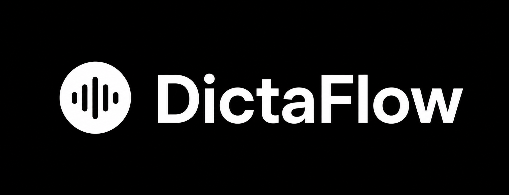
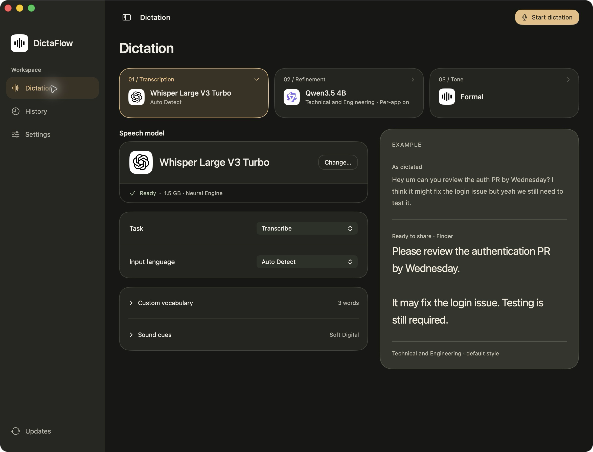
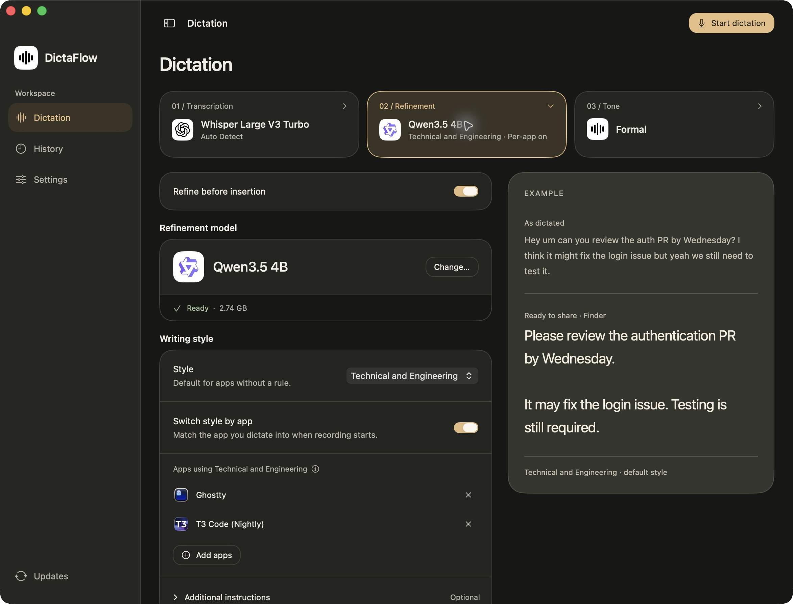

<p align="center">
  
</p>

<p align="center">
  <strong>Private dictation that types where you work.</strong><br>
  Turn spoken thoughts into text, right in the app you’re using. All on your Mac.
</p>

<p align="center">
  <a href="https://github.com/rmscoal/dictaflow/releases/latest"></a>
  
  
  
  <a href="LICENSE"></a>
</p>

<p align="center">
  <a href="https://github.com/rmscoal/dictaflow/releases/latest"><strong>Download DictaFlow</strong></a><br>
  <sub>Apple silicon · macOS 14 or newer · No account or API key</sub>
</p>

<p align="center">
  <br>
  <sub>Your voice, your models, your Mac.</sub>
</p>

## From thought to text

An email, a quick reply, a technical note. Say what you want to write, and
DictaFlow puts the text where your cursor is. Start and stop with a global
shortcut or from the menu bar, without switching away from your work.

DictaFlow is a native macOS app. Speech recognition and optional text cleanup
run locally, with no cloud transcription, analytics, or account to manage.
Once your models are downloaded, you can dictate offline.

- **Speak your language.** Transcribe in many languages, or translate supported speech into English.
- **Make it sound like you.** Keep the transcript as spoken, or use optional local refinement for clearer wording and punctuation.
- **Match the app.** Choose a writing style for each app, such as casual messages in chat and technical notes in your editor.
- **Teach it your words.** Add names and specialist terms to custom vocabulary to help recognition.
- **Pick up where you left off.** With history enabled, revisit recordings, compare original and refined text, copy a result, or try again.

## Start dictating

1. Download the DMG from the [latest release](https://github.com/rmscoal/dictaflow/releases/latest) and drag **DictaFlow** into **Applications**.
2. Open DictaFlow. In **Dictation → Transcription**, choose and download a speech model.
3. Allow microphone access when asked. For automatic text insertion, allow Accessibility access when needed.
4. Place your cursor in the app you want to write in. Press your dictation shortcut, speak, then press it again to finish.

Find or change your shortcut in **Settings → General**. If automatic insertion
is unavailable, DictaFlow offers a copy panel so you can paste the result yourself.

Public releases are signed and notarized. You need an Apple silicon Mac running
macOS 14 or newer, plus an internet connection to download the app, models, and
updates. Larger models need more memory and disk space.

## A little cleanup, your way

Use **Dictation → Refinement** to turn rough speech into text that is easier to
share. Choose a local model and a writing style: Normal Cleanup, Professional
Formal, Casual Text Messaging, or Technical and Engineering. Add your own
instructions, or use DIY for a fully custom prompt.

You can assign styles to individual apps and let DictaFlow switch when you
start recording. Separate **Tone** controls offer Original, Balanced, Casual,
and Formal options, even when refinement is off.

<p align="center">
  <br>
  <sub>Choose how your text reads, with processing that stays on your Mac. The preview uses sample text.</sub>
</p>

Refinement is optional. If it cannot complete, DictaFlow keeps the original
transcription and applies your selected tone. You can review saved results in
**History** before reusing them.

## Local by design

Your audio and text stay on your Mac during transcription and refinement.
DictaFlow uses local [Whisper](https://github.com/ggml-org/whisper.cpp) speech
models and [llama.cpp](https://github.com/ggml-org/llama.cpp) for optional text
refinement. No subscription or cloud inference is required.

Download models from their **Change…** buttons in Dictation. Choose a smaller
model for a lighter setup or a larger one when accuracy matters more. Downloads
are checksum-verified before use, and supported speech models offer optional
Neural Engine acceleration.

You control what stays on disk:

- **Models** stay until you remove them. Open **Settings → General → Storage** to find local model files and manage storage.
- **History** keeps recordings and text for your selected retention period. With history off, recordings are temporary.
- **Clipboard insertion** restores the previous clipboard contents when possible.

Update checks use GitHub Releases and send no transcripts, recordings, or usage
data. You can turn automatic checks off. To update, open **Updates**, download
the new DMG, and replace DictaFlow in Applications.

## Need a hand?

| If… | Try… |
| --- | --- |
| Recording will not start | Check microphone access in **Settings → Permissions**. |
| Text is not inserted | Check Accessibility access in **Settings → Permissions**, or use the copy panel. |
| Recognition misses words | Set the input language, add custom vocabulary, or try a larger speech model. |
| The first dictation takes longer | Give the selected local models time to load. |
| You want to recover a previous result | Open **History**, if recording history was enabled. |

For bugs or suggestions, [open an issue](https://github.com/rmscoal/dictaflow/issues).

## Build and contribute

DictaFlow is open source. Contributions that keep it private, local, and pleasant
to use are welcome. Read [CONTRIBUTING.md](CONTRIBUTING.md) to get started.

With Xcode installed, clone the repository and run:

```sh
make run
```

This builds, installs, and launches **DictaFlow Dev**. Use `make build` to install
without launching, or `make verify` to check the installed app’s signature and
launch it. The main Xcode scheme is `DictaFlow Dev`; see the
[verification guide](Tests/README.md) for tests and manual checks.

## License

DictaFlow is licensed under the [GNU Affero General Public License v3.0 or later](LICENSE).
Third-party notices are listed in [THIRD_PARTY_NOTICES.md](THIRD_PARTY_NOTICES.md)
and [NOTICE](NOTICE).
