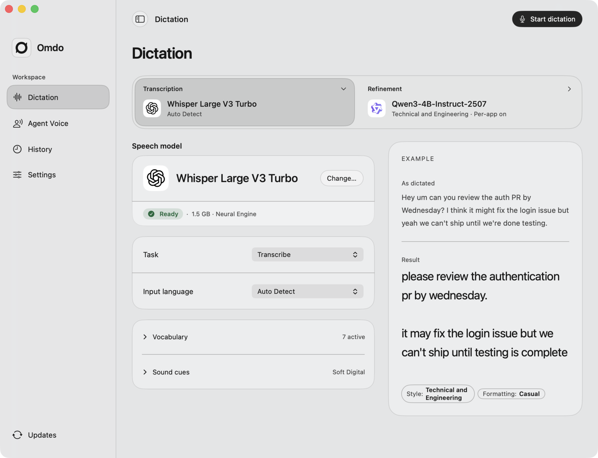
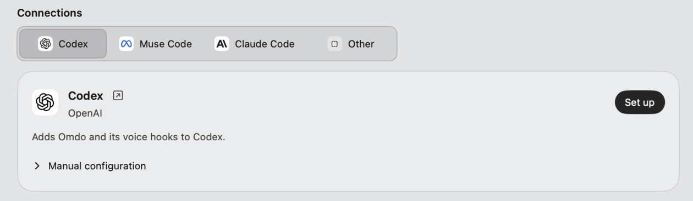
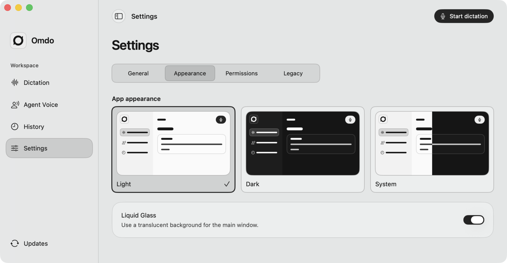

# Omdo

  <strong>Work out loud.</strong> 
  Talk through a problem with your coding agent and hear its reply. Dictate into the apps you already use, with speech processing on your Mac.

  
  
  
  
  

  <a href="https://github.com/rmscoal/dictaflow/releases/latest"><strong>Download Omdo for Mac</strong></a> 
  Built to run locally

  

## Start dictating

You’ll need an Apple silicon Mac with macOS 14 or later. The model picker shows
each download size before you choose.

1. Download the latest `Omdo-…-arm64.dmg`, open it, and drag **Omdo** into **Applications**. Public releases are signed and notarized.
2. Open **Dictation → Transcription** and use **Change…** or **Download…** to choose a speech model. If you choose Liquid, Omdo directs you to **Agent Voice** to download its shared model.
3. Allow microphone access when prompted. Allow Accessibility access if you want Omdo to insert text automatically.
4. Place your cursor where you want the text. Press the default shortcut <kbd>⌘</kbd> <kbd>⇧</kbd> <kbd>&#92;</kbd> to start, speak, then press it again to finish. You can also start dictation from the menu bar.

Find or change your shortcut in **Settings → General**. If Omdo can’t insert
the result, it opens a copy panel so you can paste it yourself.

## Hear your coding agent

Dictate a prompt into your coding app, send it, and listen to the reply.
Omdo uses a local Liquid model to speak replies. Choose automatic playback
or use **Play on request** to listen when you’re ready.

1. Open **Agent Voice → General**, turn on **Enable Agent Voice**, and download the speech model if needed.
2. Choose a voice, accent, and speed, then click **Test speech** to hear a sample.
3. Under **Connections**, choose your coding app and quit it. For Codex or Muse Code, click **Set up** in Omdo. For Claude Code or another host, follow the manual configuration on its card.
4. Start a new session in your coding app. In Codex, use `/hooks` to review and trust the changed hooks.

See the [Agent Voice setup guide](Docs/AgentVoice.md#setup-and-host-boundaries)
for supported host versions and manual setup.

## Write the way you want

- **Dictate in your language.** Choose local Whisper or Liquid speech recognition. With Whisper, set the input language or translate compatible speech into English.
- **Clean up rough speech.** Open **Dictation → Refinement** to remove filler, clean up punctuation, or give a local model your own instructions. Assign different writing styles to different apps, such as casual chat and technical notes.
- **Choose the finishing touches.** Set **Final formatting** to Casual, Original, or Formal. It also works with refinement off. Add names and specialist terms in **Dictation → Transcription → Vocabulary**.
- **Revisit what you said.** With history enabled, open **History** to compare original and refined text, copy or insert a result again, or retry it.

## Local by design

Transcription, optional refinement, and Agent Voice playback run on your Mac.
Omdo has no analytics or cloud transcription. You’ll need an internet
connection to download the app, models, and updates. Once your models are in
place, you can dictate offline.

Omdo uses [whisper.cpp](https://github.com/ggml-org/whisper.cpp) and Liquid for
speech recognition, Liquid for Agent Voice speech, and
[llama.cpp](https://github.com/ggml-org/llama.cpp) for optional refinement.
Model downloads are verified before use. Some Whisper models support Neural
Engine acceleration.

Manage model files under **Settings → General → Storage**. Choose how long to
keep recordings and text under **History → History settings**, or turn history
off. Omdo tries to restore your clipboard contents after clipboard-based
insertion. Automatic update checks use GitHub Releases and can be turned off
in **Updates**.

## Make Omdo feel at home

Open **Settings → Appearance** to choose Light, Dark, or System. Turn on
**Liquid Glass** for a translucent main window when macOS allows transparency.

## Upgrading from DictaFlow

Quit older copies of DictaFlow before opening Omdo. On first launch, Omdo
migrates local history, refinement prompts, and Agent Voice history. It also
tries to reuse verified models. If a model needs attention, follow the in-app
instructions to restore it or choose another one.

After migration, **Settings → Legacy** lists previous data when it’s
still on disk. Use **Show in Finder** to inspect it, or **Remove previous data**
after you’ve checked that your migrated data is available. You can also reach
the tab from **Previous DictaFlow data…** in the menu bar.

If you set up Agent Voice in DictaFlow, quit the coding app you connected,
such as Codex or Muse Code. In Omdo, open **Agent Voice → General → Connections**,
select that app, and click **Update** if it appears. If Omdo has no update
button, follow the [host setup guide](Docs/AgentVoice.md#setup-and-host-boundaries).
Start a new session afterward. In Codex, review and trust the changed hooks with
`/hooks`.

If you still use DictaFlow or Omdo Dev, keep the model files in
`~/Library/Application Support/DictaFlow/Models`. Those apps may still load
models from that folder.

## Help and development

- **Recording won’t start.** Check microphone access in **Settings → Permissions**.
- **Text doesn’t appear at the cursor.** Check Accessibility access under **Settings → Permissions**, or use the copy panel.
- **Recognition misses words.** Set the input language when available, add custom vocabulary, or try another model.

[Open an issue](https://github.com/rmscoal/dictaflow/issues) for bugs or suggestions.

To build and launch **Omdo Dev**, install Xcode, clone the repository, and run
`make run`. The main Xcode scheme is `DictaFlow Dev`. See
[CONTRIBUTING.md](CONTRIBUTING.md) and the [verification guide](Tests/README.md)
for development and testing.

Omdo is licensed under the [GNU Affero General Public License v3.0 or later](LICENSE).
See [THIRD_PARTY_NOTICES.md](THIRD_PARTY_NOTICES.md) and [NOTICE](NOTICE) for
third-party notices.
